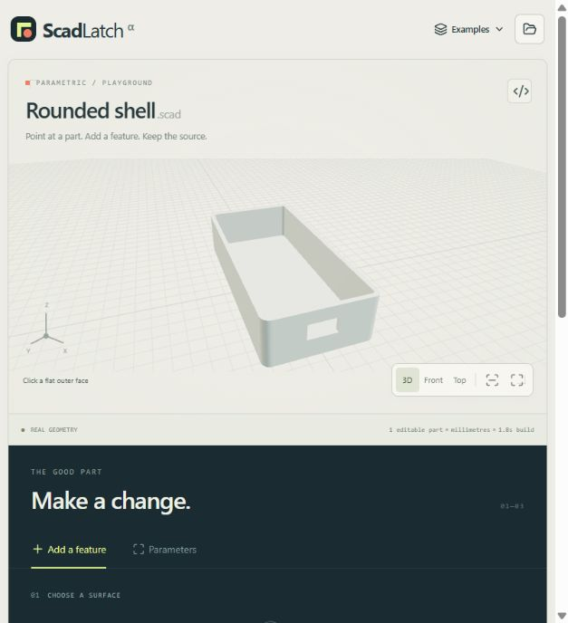

# ScadLatch

**Point to a face. Add a feature. Keep the parameters.**

ScadLatch is for people who find a useful OpenSCAD model but need a
change its original controls do not offer. The first workflow is a local browser
workbench: open an existing `.scad` file, select a supported flat face, add a round hole or a
rectangular opening, and keep the change in editable OpenSCAD source.

The important part comes next: change the original dimensions, and the new
feature stays attached to its chosen face. Export both the modified source
and an STL compiled by the actual OpenSCAD engine.

[中文说明](README.zh-CN.md)

[42-second tray walkthrough](docs/media/walkthrough.mp4) · [Independent source-package check](docs/release-reproduction.md)

The walkthrough uses actual screenshots from the earlier box-based tray workflow.



> **Development alpha, 26 October 2026.** Local setup and the source-edit,
> parameter-change and native STL-generation path have passed engineering checks.
> The earlier box workflow passed browser checks and an independent Windows
> installation check. Rounded hulls and extruded profiles now have native-engine
> checks; their complete browser workflow has not yet been checked independently.
> An external rounded enclosure was edited and resized successfully, with inherited
> mesh defects; two other external attempts remain incomplete or timed out.
> [All three results](docs/imported-model.md) are retained. No public release or
> measured user adoption is claimed.

## The first task

You have a parametric enclosure. It needs a cable opening on one side, but the
original author did not expose a control for that opening.

The workflow is:

1. Open the existing, self-contained SCAD file.
2. Select the face and the particular instance you want to modify.
3. Choose a circular hole or rectangular opening and set its placement and size.
4. Review the rebuilt solid, then change an original dimension to check that the
   opening follows the intended face.
5. Save the modified SCAD and compiled STL. Use the SCAD in OpenSCAD, or save a
   `.scadlatch.json` project to continue editing in ScadLatch.

Edits preserve the original geometry and parameter expressions. The selected
outer plane follows the model's dimensions; the opening's size stays in millimetres.
Placement across that plane has an explicit rule:

| Selected body | Placement of the opening's center |
| --- | --- |
| `cube()` | Fixed millimetre offsets from the two lower edges |
| `hull()` or `linear_extrude()` | Fixed coordinates relative to that body's original local origin; values may be negative |

Neither rule automatically recenters the opening when a dimension changes.
Explicit module instances have distinct edit routes, so selecting one does not
apply the cut to every call of that module.

## How this differs

| Existing approach | What it is good at | ScadLatch's approach |
| --- | --- | --- |
| OpenSCAD Customizer and parameter sliders | Changing controls the author exposed | Add a feature that was absent from those controls |
| Mesh editors and mesh Boolean tools | Cutting or adding geometry to a fixed mesh | Keep the edit related to the original generating parameters |
| Visual CSG editors | Building and manipulating primitives and Boolean trees | Apply a local structural change to an imported source program |
| AI source editors, including PurCad | Requesting changes to existing SCAD in natural language | Specify a particular face and instance directly, with an explicit, inspectable attachment rule |

ScadLatch is focused on this remix workflow: point to an existing part, add a
missing feature, and keep using the original parameters. It supports the forms
below; it does not replace a general CAD editor.

## Initial scope and limits

- Input: one self-contained OpenSCAD source file.
- Editable bodies: supported `cube()`, whole `hull()` bodies and whole
  `linear_extrude()` bodies. A selectable face must be exposed, flat, aligned with
  the body's local axes, and at a minimum or maximum of its local bounds.
  Curved surfaces, sloping surfaces and recessed ledges are not selectable.
- New features: a circular hole or rectangular opening.
- Output: editable SCAD, an OpenSCAD-compiled STL, and a saved ScadLatch project.
- Explicit repeated module calls are treated as distinct selectable instances.
  Repeated instances generated inside loops are outside the initial editing scope.
- Complex libraries, `include`/`use` dependencies and imported external assets are
  outside the first version. This is not a general editor for every SCAD program.
- A supported hull or extrusion is edited as one body, preserving its original
  construction. Its internal primitives are not separate editable faces.
  `minkowski`, `intersection`, offset profiles, twisted extrusions and nonuniform
  scaling are outside the direct-editing scope. Background geometry and Boolean
  subtractors are not selectable solid parts.
- The opening must fit within the body's local bounds. Those bounds may include
  empty areas in a concave shape: inspect the actual result, including partial
  cuts. The interface reports cuts that remove no measurable material. Invalid
  edits and failed rebuilds retain the last successful model.
- Unknown modules/functions/variables and invalid geometry parameters stop the
  build, even if OpenSCAD could otherwise return a partial model.
- A positive depth cuts inward from the selected outer plane, even on a concave
  body; it does not start from the floor of an existing hole. A through cut
  crosses the whole selected body and can also open its opposite wall.
- Keep the saved project for continued face editing. Exported SCAD contains the
  generated edits and is intended for OpenSCAD; re-importing that generated code
  as a new ScadLatch source is not supported.
- Compiling a solid does not establish printability, fit, strength or safety.
  Inspect dimensions and the sliced result before making a physical part.

Unsupported direct edits are reported explicitly. Rendering and source parsing
support different scopes: a model can compile successfully without containing
an editable face. This is a local workbench; do not expose its server to a
network as a public rendering service.

## Getting started

The application uses a browser interface and a local Node.js server that calls the
native OpenSCAD command-line engine. It does not depend on a hosted model API.

Requires **Node.js 22 or newer**. From this project's directory:

```sh
npm install
npm run setup
npm run dev
```

Open `http://127.0.0.1:4173`. On Windows, setup finds an existing OpenSCAD or
downloads the official OpenSCAD 2021.01 portable build (about 22 MB). On macOS
and Linux, install OpenSCAD first or set `OPENSCAD_BIN` to its executable, then
run setup. A clean Windows setup has been independently reproduced; macOS/Linux
setup and the browser compatibility matrix have not yet been independently checked.

For a first task, choose the included **Rounded shell** example:

1. Click the flat right outer wall, labeled **X+**.
2. Add a rectangular opening: **Width 18 mm**, **Height 10 mm**,
   **Local Y position 32 mm**, **Local Z position 17 mm**, **Cut depth 5 mm**.
3. Apply the opening and inspect the cut through the 3 mm wall.
4. In Parameters, change `width` from **100 to 140**, then rebuild. The opening
   should follow the right wall, keeping the same local Y/Z position.
5. Export SCAD and STL, and save a project if you want to continue editing here.

The depth is enough to open this wall without reaching the opposite wall.
Choosing a through cut would also open the opposite wall.

OpenSCAD runs locally as a separate process. The interface uses Three.js, the
local server uses Express, and source analysis uses openscad-parser. Installation
requires network access for dependencies. Source and rendering stay on the local
server; there is no account or model API key to configure.

## Verification and contributions

Run the source, scope and validation checks, then the actual STL workflow:

```sh
npm test
node --import tsx scripts/check-workflow.ts
node --import tsx scripts/check-compound-workflow.ts
npm run build
```

These checks compile actual geometry, measure material removal after resizing,
and verify that an unselected instance stays unchanged. They cover a box-based
tray, two rounded hull-based trays and a rotated extruded profile. Source tests
also check that a blind cut on a concave body leaves lower ledges untouched.
Outputs are in `.cache/workflow/` and `.cache/compound-workflow/`.

The [external-model record](docs/imported-model.md) includes a completed rounded
enclosure wall edit, a phone-holder extrusion whose hole placement was not
completed, and a phone stand that timed out. The successful enclosure still has
mesh defects inherited from its source. These are engineering checks, not proof
of printability, broad compatibility or user adoption. An unfamiliar human
user's complete first-use workflow remains outstanding.

A useful contribution is a
rights-cleared, self-contained SCAD example with a precise desired edit and the
parameter changes it must survive. Include the model's license and attribution.
Do not submit proprietary source without permission.

## License

ScadLatch's original source is licensed under **GPL-3.0-or-later**; see [LICENSE](LICENSE).
Third-party components keep their own notices and terms; see
[THIRD_PARTY_NOTICES.md](THIRD_PARTY_NOTICES.md). OpenSCAD is obtained separately
from its official distribution and used as a local command-line tool.

Your model retains its existing license. Using ScadLatch does not itself change
the rights attached to imported model source or geometry.
